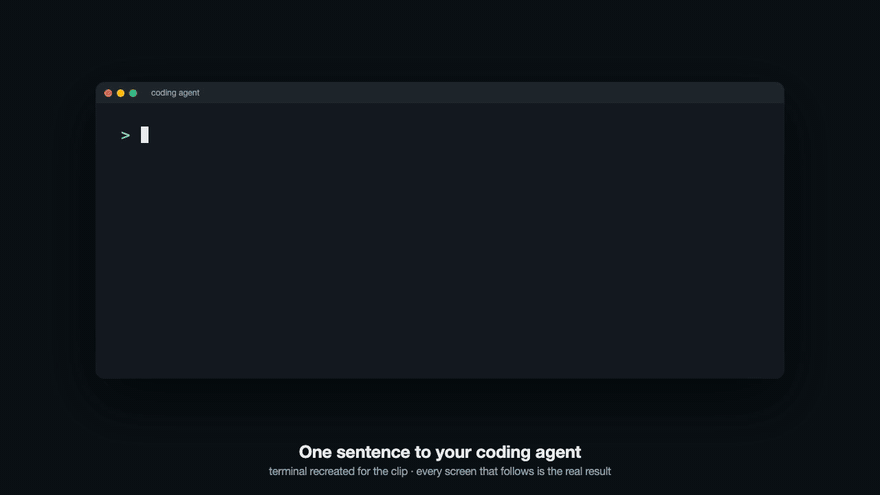
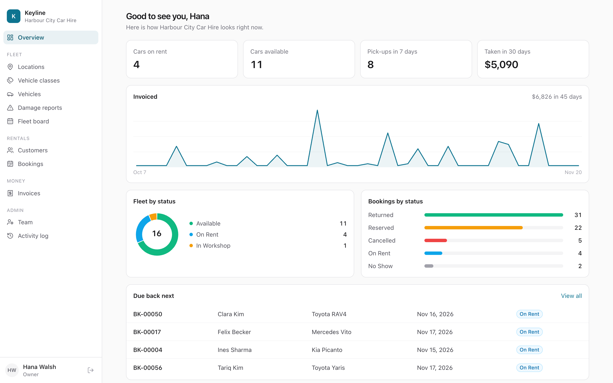
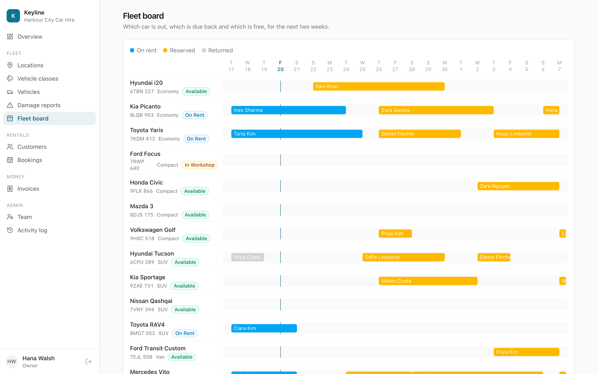
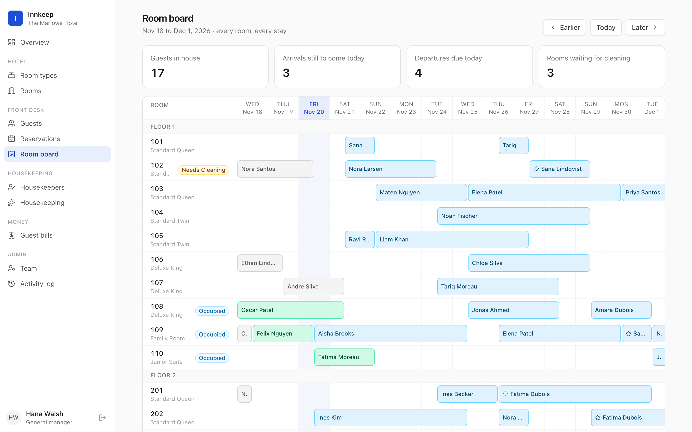
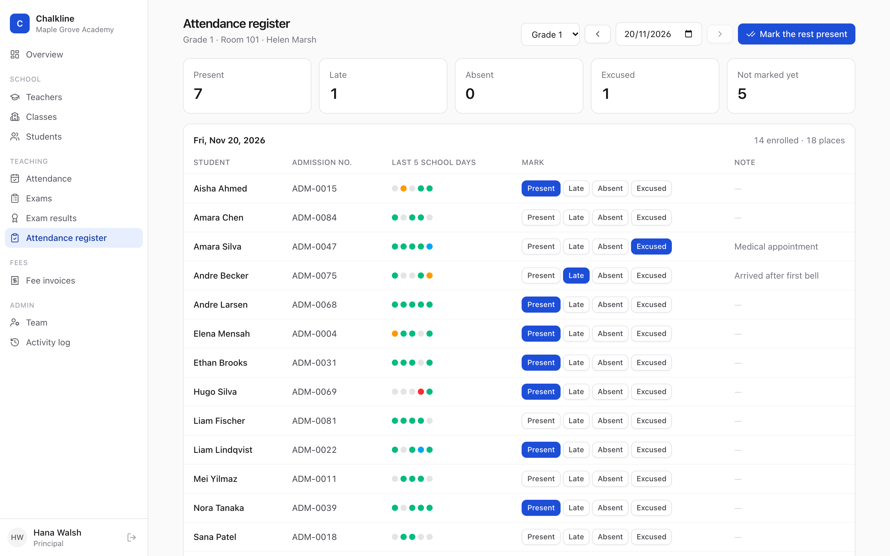
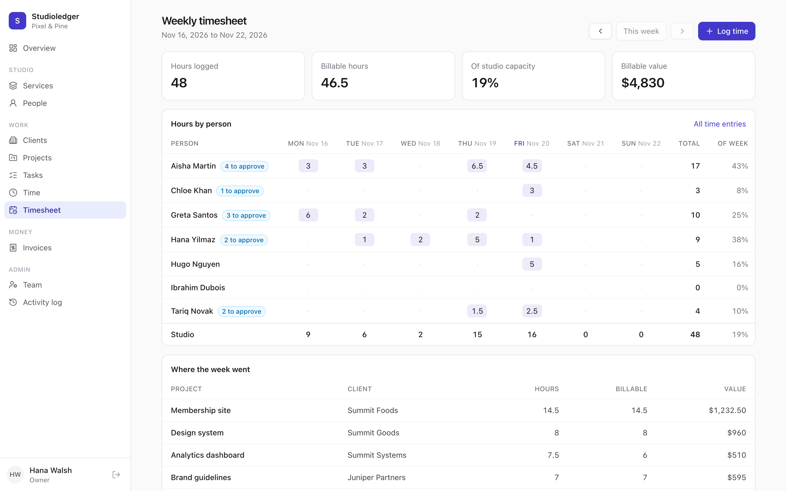

# backoffice

**One sentence about a business in, a working management system out.**

`backoffice` is an agent skill. Tell your coding agent "build me a system for my gym" (or clinic, car
rental, guesthouse, agency, school) and it designs the business, generates a complete multi-tenant admin
system, and proves it works with an automated check before it tells you it is done.

```text
> Build me a system for a small car rental company: vehicles, bookings and damage reports.
```



*The terminal in the clip is recreated; every application screen is a real capture of the generated system.*

The result of that one sentence, from a 256-line config the agent wrote, with no hand-written demo data:





It is not only car rental. Fresh agents, given one sentence each and nothing but this skill, built
these as well. The configs and custom screens are in [`examples/`](examples).

| Hotel: room board | School: attendance register | Agency: weekly timesheet |
|---|---|---|
|  |  |  |

What you get, running on your machine a few minutes later:

- sign-in, with separate organisations that cannot see each other's data
- roles that are really different: per-section permissions, hidden fields, steps only some roles may take
- searchable, sortable, filterable tables with CSV export; forms with validation
- status workflows ("Hand over keys", "Check in", "Mark paid") that update linked records
- business rules: no double booking, capacity limits, calculated totals, automatic reference codes
- a dashboard with date-aware tiles ("today", "overdue", "next 7 days"), charts and lists
- team management and an activity log for the owner
- demo data that holds together: past classes are completed, paid invoices have a payment date
- one custom "signature" screen for the business (a timetable, a fleet calendar, a room board)

## How it works

Agents are good at judgement and bad at writing the same CRUD code correctly forty times. So the skill
splits the work:

1. **The agent designs the business** and writes one file, `system.config.ts`: the records, the roles, the
   lifecycle, the rules, the dashboard.
2. **A bundled template turns that file into the app**: database, API, every screen, demo data.
3. **`npm run verify` proves it**: it type-checks, builds, boots the server and exercises every section as
   every role (permissions, hidden fields, every status step and its side effects, business rules, tenant
   isolation, custom routes). The agent is told not to say "done" until every check passes.

The generated app is plain, readable code you own: Node (built-in SQLite, no native modules), Express,
React, Vite, Tailwind. One process, one port, no accounts, no API keys.

## Install

Needs Node 22.13 or newer.

The skill is the `skills/backoffice` folder. Copy it to wherever your agent loads skills from.

**Claude Code**
```bash
git clone https://github.com/tabishhassan5121472/backoffice-skill
mkdir -p ~/.claude/skills && cp -R backoffice-skill/skills/backoffice ~/.claude/skills/
```

**Other agents** (Codex, Cursor, Gemini CLI and others that read `SKILL.md` folders): copy
`skills/backoffice` into that agent's skills folder. The skill is plain Markdown plus Node scripts and
uses nothing specific to one agent. It has been tested in Claude Code; reports from other agents are welcome.

Then ask for a system:

```text
Use the backoffice skill: a system for my dental clinic.
```

## What is in the box

```text
skills/backoffice/
  SKILL.md                      the workflow the agent follows
  references/domain-design.md   how to model a business: core record, roles, rules, dashboard
  references/config-reference.md  every option of system.config.ts
  references/blueprints/        ready designs: gym, clinic, hotel, school, agency, car rental
  scripts/create.mjs            copies the template into a new project
  assets/kernel/                the app template, including scripts/verify.mjs
examples/                       four generated systems you can run: car rental, hotel, school, agency
```

A taste of the config:

```ts
{
  name: 'bookings', label: 'Bookings', singular: 'Booking', title: 'reference',
  fields: [
    { name: 'reference', type: 'text', auto: 'BK-{seq:5}' },
    { name: 'vehicle_id', type: 'ref', ref: 'vehicles', required: true },
    { name: 'pickup_on', type: 'date', required: true },
    { name: 'return_on', type: 'date', required: true },
    { name: 'total', type: 'money', compute: 'days(pickup_on, return_on) * vehicle_id.daily_rate' },
  ],
  status: {
    field: 'status', initial: 'reserved',
    states: [...],
    transitions: [
      { from: ['reserved'], to: 'on_rent', label: 'Hand over keys',
        then: [{ update: 'vehicle_id', set: { status: 'on_rent' } }] },
      { from: ['on_rent'], to: 'returned', label: 'Check in', set: { returned_on: 'today' },
        then: [{ update: 'vehicle_id', set: { status: 'available' } }] },
    ],
  },
  rules: [
    { check: 'return_on >= pickup_on', message: 'The return date cannot be before the pick-up date.' },
    { noOverlap: { per: 'vehicle_id', start: 'pickup_on', end: 'return_on' }, unless: { status: 'cancelled' },
      message: 'This vehicle is already booked for those dates.' },
  ],
}
```

## What it is not

A generated system is a strong starting point and a convincing demo, not a finished product. It does not
include real payments, email or SMS, file uploads, or production hosting, and the demo data is rebuilt
whenever the config changes. Anything handling real customer, health or payment data needs a proper
review before it goes live.

## Contributing

Blueprints are the most useful contribution: a one-page design for a business you know well (see
`references/blueprints/gym.md`). Bug reports with the `system.config.ts` that triggered them are next.

## Need one built for your business?

The skill gets you a working first version. If you want it taken further, with your own workflows, real
payments or email, and hosting, I build these for clients:
[Fiverr](https://www.fiverr.com/tabish_hassan_) · [Contra](https://contra.com/tabishhassan01998_zktf42k3) ·
[tabishapps.com](https://tabishapps.com).

## Licence

MIT. Built by [Tabish Hassan](https://tabishapps.com).
