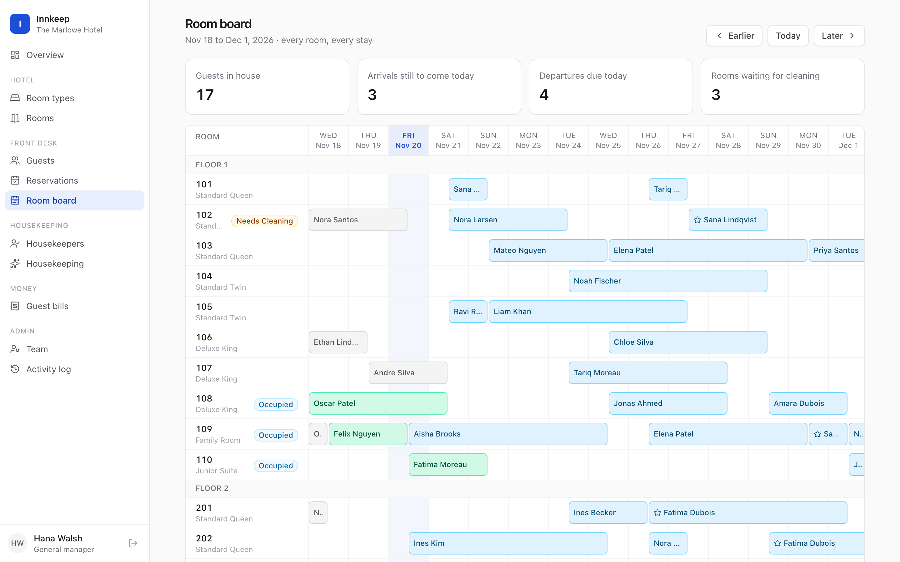
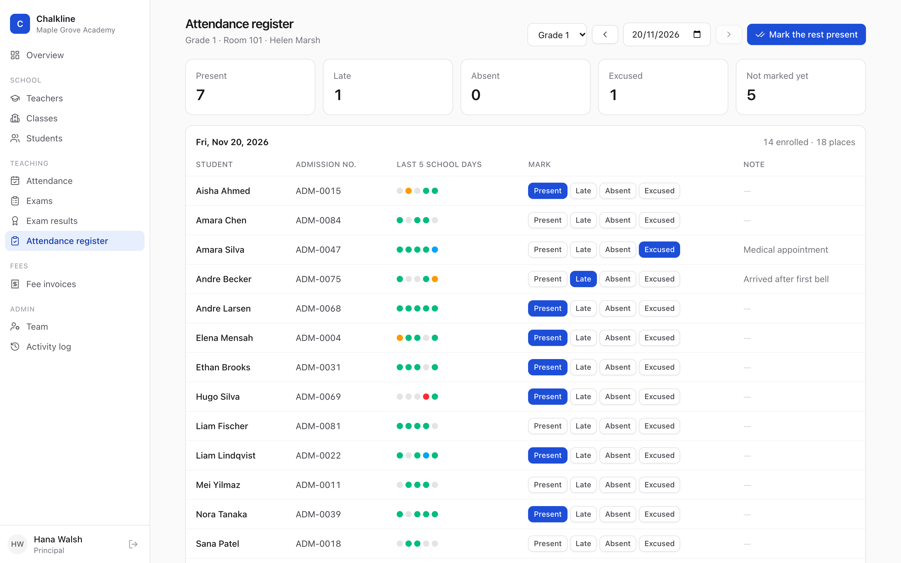
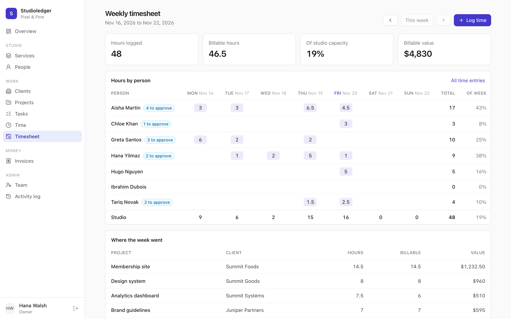
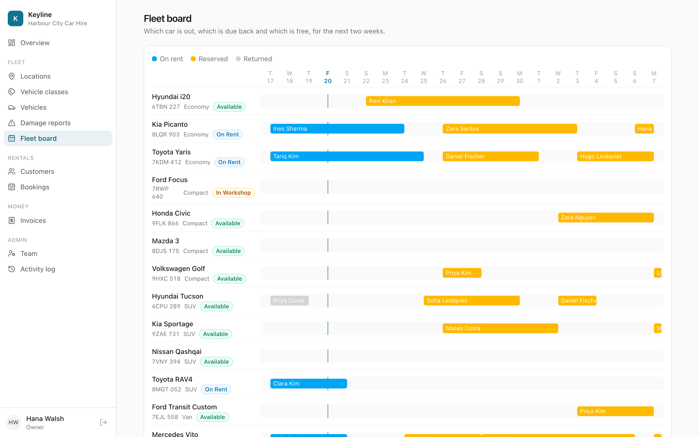

# Examples

Four systems an agent produced with this skill, each from one sentence. Every folder holds the only
files the agent wrote: `system.config.ts`, plus one custom screen and its API route.

| Example | The sentence | Config | Checks |
|---|---|---|---|
| [car-rental](car-rental) | "a small car rental company: vehicles, bookings and damage reports" | 256 lines | 202 of 202 |
| [hotel](hotel) | "a 40-room city hotel: rooms and room types, reservations with check-in and check-out, housekeeping, and guest bills" | 259 lines | 195 of 195 |
| [school](school) | "a small private school: students, classes, teachers, attendance, exam results and fee invoices" | 243 lines | 186 of 186 |
| [agency](agency) | "a small digital agency: clients, projects, tasks, time tracking and invoices" | 280 lines | 209 of 209 |

The configs are as the agents wrote them, with one edit: the school's "school days only" rule now uses
`weekday()`, which was added to the template because of that run.

## Run one

```bash
node skills/backoffice/scripts/create.mjs my-hotel
cp -R examples/hotel/system.config.ts examples/hotel/server examples/hotel/web my-hotel/
cd my-hotel
npm install
npm run verify     # optional: runs every check
npm run dev        # http://localhost:5173, demo accounts are listed on the sign-in page
```

## What they look like

**Hotel: room board**


**School: attendance register**


**Agency: weekly timesheet**


**Car rental: fleet board**

